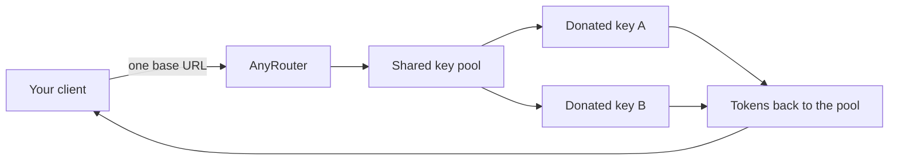

# A shared key pool, and a free-token pool on the other side

> AnyRouter started as one URL in front of many models. The part that actually matters is the pool: people donate spare provider keys, the gateway routes around them, and everyone else draws a free-token pool instead of hunting for a working key.

- Date: September 9, 2026
- Category: product
- HTML: https://blog.anyrouter.dev/intro

## The idea, without the pitch deck

I got tired of wiring a new SDK every time a model was worth trying. Each provider has its own key, its own 429, its own way of saying no. You either collect keys like baseball cards or you pick one vendor and hope they stay up.

AnyRouter is the boring fix: one OpenAI- and Anthropic-compatible URL. Point Claude Code, Cursor, the AI SDK, or a raw curl at [anyrouter.dev](https://anyrouter.dev) and pick a model id. Failover is the gateway's job. You should not see the hops.

That is table stakes. The interesting part is what sits behind the URL.

## Spare keys sitting idle

A lot of us already pay for a provider plan — Gemini, a Z.ai coding sub, a Moonshot key, an NVIDIA NIM trial — and then barely touch the quota. That headroom expires. Meanwhile someone else is stuck on a 429.

The shared pool is the swap. You add a key under BYOK, flip Donate to pool, and confirm once that other people's requests may go through it. The gateway picks a donated key, sends the call upstream, and you earn pending credits from the traffic — capped at $1 per key per UTC day. That dollar is a donor cap, not a plan price.

Details and the click-by-click: [Donate an idle provider key](https://anyrouter.dev/blog/shared-key-pool) and the donate page at [anyrouter.dev/donate](https://anyrouter.dev/donate).

## What users get: a free-token pool

On the other side of those donated keys is the reason the product exists: a pool of tokens people can actually spend without shopping for a working key first.

Sign in, take a key from the dashboard, and route. Pool-backed models are the ones the donated keys feed. Reciprocity still applies — to keep drawing from the pool you keep at least one donated key of your own healthy. That gate is live; it is not a slogan.

If you would rather not donate, paid Go is the other door. Live numbers live on [Pricing](https://anyrouter.dev/pricing), not in a blog post that will rot. Older cards that say $1 Go are wrong. The donor $1/day cap is not Go.

Credits, invoices, and plan balances: the dashboard. Canonical plan copy: [docs — pricing](https://docs.anyrouter.dev/features/pricing).

## How a request actually moves

One contract in. Ranked upstreams. If the first key 429s or 401s, the next one runs. The client sees one response.



_Donated keys in; free-token pool out. The client never picks a donor._

_(Interactive embed `pool-diagram` — see the [HTML version](https://blog.anyrouter.dev).)_

## What we are not claiming

- No invented MAU, token, or uptime numbers in this post. If a figure is not on pricing, donate, or the dashboard, it does not belong here.
- Checkout is Polar card. No Alipay, no WeChat.
- Donating a key is not a ToS blessing from the upstream. That part is on you.

## If you want to try it

Three honest paths:

1. Sign in at [anyrouter.dev](https://anyrouter.dev) and grab a key.
2. Donate a spare provider key at [anyrouter.dev/donate](https://anyrouter.dev/donate) — that is also how you unlock Go without a card. Walkthrough: [Donate a key for Go](https://anyrouter.dev/blog/donate-a-key-for-go).
3. Or pay on [Pricing](https://anyrouter.dev/pricing) and spend credits.

```bash
curl -fsSL https://anyrouter.dev/setup.sh | bash
anyr login
anyr claude

curl https://anyrouter.dev/api/v1/chat/completions \
  -H "Authorization: Bearer $ANYROUTER_API_KEY" \
  -H "Content-Type: application/json" \
  -d '{"model":"google/gemini-3.5-flash","messages":[{"role":"user","content":"Hi"}]}'
```

_Same contract as every other post — anyrouter.dev only._
