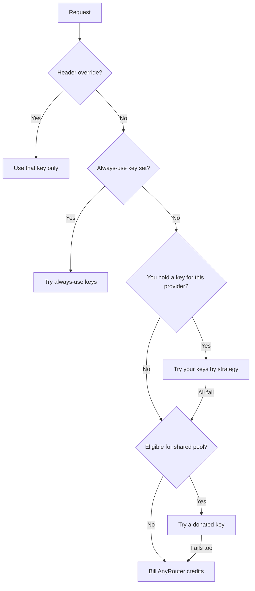
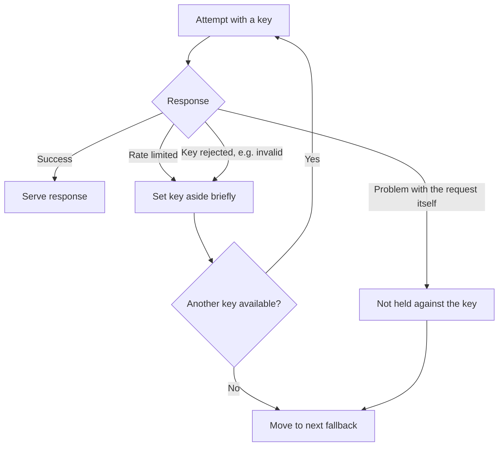

# How AnyRouter Chooses a Credential

> The order AnyRouter checks your own provider keys, the shared pool, and AnyRouter credits — and what happens when a key is rate limited or fails.

# How AnyRouter Chooses a Credential

Every request can be served three different ways: through **your own provider key**, through the **community shared pool**, or against your **AnyRouter credits**. This page is the map of how AnyRouter decides which one actually handles a given request, and what happens when the first choice doesn't work out.

## Overview

| Source | Who pays the upstream | Requires |
|---|---|---|
| Your own BYOK key | You, at the provider's list price | Adding a key on the [BYOK](/features/byok) page |
| Shared pool | A donor's provider account | You've [donated a key](/features/shared-pool) or hold a paid plan |
| AnyRouter credits | AnyRouter | Nothing extra — this is the default |

Using your own key is always attempted before AnyRouter reaches for anything else. The shared pool is additional capacity available to donors and paid-plan accounts on top of that. Credits are the catch-all: if nothing else served the request, it's billed against your AnyRouter balance. **BYOK requests are never charged to your credits, whether they succeed or fail.**

## How it works

### Your own keys come first

If you've added a BYOK key for the provider a request needs, AnyRouter tries it before anything else. You can also pin a single key for one request with the `X-AnyRouter-BYOK-Key` header, or mark a key **Always use** so it's the only thing tried for matching models. See [BYOK: Routing precedence](/features/byok#routing-precedence-byok-vs-managed-capacity) for the exact ordering and what happens if a pinned or always-use key isn't available.

### Choosing among several of your own keys

When you have more than one key for the same provider, a per-provider strategy decides which one goes first:

- **Fallback** (default) — try keys in priority order; move to the next on error.
- **Round Robin** — cycle through enabled keys evenly.
- **Weighted** — send requests proportional to each key's configured weight.
- **Random** — pick a key at random per request.

You set this on the provider's card in **Dashboard → BYOK**. Full details in [BYOK: Load balancing multiple keys](/features/byok#load-balancing-multiple-keys).

### The shared pool

If you don't have a working key for the provider — or your own keys are temporarily unavailable — and you're eligible for the shared pool (you've donated a key, or you're on a paid plan), AnyRouter can route the request through a donated key from another user's account instead of billing your credits. See [Share a Key to the Shared Pool](/features/shared-pool) for eligibility and how donating works.

### Falling back to credits

If none of the above apply — no BYOK key, not eligible for the pool, or every attempt above failed — the request is billed against your AnyRouter credits at the provider's list price, with no AnyRouter markup. This is the same managed capacity used by accounts with no BYOK keys at all.

## What happens when a key fails or gets rate limited

A single failed attempt doesn't fail the whole request. AnyRouter retries, and a retry can land on a different key of the same provider before the router gives up on that provider and moves to the next option in the order above.

- **Rate limited.** A key that gets rate limited by its provider is set aside for a short cooldown and skipped by the router, then automatically returns to rotation once the cooldown passes. Being throttled doesn't mark a key as broken.
- **Rejected.** A key the provider actively rejects (for example, an invalid or revoked credential) is parked the same way a rate-limited key is, so it stops being tried until you fix it.
- **Bad request.** If a request is rejected because of something in the request itself — not the credential — that isn't held against the key; the same key stays eligible for your next request.

For the general routing and failover mechanics that apply after a credential is chosen (candidate ordering, provider preferences, forcing a specific upstream), see [Smart Routing](/features/routing). For request-rate ceilings independent of any single key, see [Rate Limits](/features/rate-limits).

## Related

- [Bring Your Own Key (BYOK)](/docs/features/byok.md)
- [Share a Key to the Shared Pool](/docs/features/shared-pool.md)
- [Smart Routing](/docs/features/routing.md)
- [Rate Limits](/docs/features/rate-limits.md)
- [Credits & Billing](/docs/features/credits.md)
